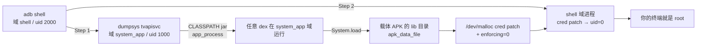

# OPPO K9 电视(OPPOCNM632 / m7332)root 研究

- 目标设备:`OPPOCNM632`(OPPO K9 电视),平台 `m7332`(MT9632),Android 9,内核 4.9.118(32 位用户态)
- 访问方式:局域网 adb(`<TV_IP>:5555`)
- 时间跨度:2026-10-28 起,最后更新 2026-10-30
- 成果:**按需获取完整 root**(`uid=0` + 满 capability + SELinux Permissive),无常驻服务、无监听端口、默认保持 Enforcing

## 一句话原理

设备固件遗留了 MStar 调试节点 `/dev/malloc`(`crw-rw-rw-`),配合 ioctl+mmap 可读写**内核物理内存**;
据此把当前进程的 `cred` 结构 patch 成 `uid=0`,并把 SELinux 的 `enforcing` 标志位写 0。



## 快速操作

```bash
adb connect <TV_IP>:5555

# Step 1 — 放开 SELinux(约 40s;设备每次重启后需先跑一次)
adb shell 'dumpsys tvapisvc -cmd "sh /sdcard/r1.sh"'

# Step 2 — 终端直取 root
adb shell                      # 或: adb shell 'sh /data/local/tmp/su.sh id'
$ sh /data/local/tmp/su.sh     # 交互 root shell,exit 即回普通 shell
```

原理、依赖文件、构建方法与排错见 [`docs/03-root-access.md`](docs/03-root-access.md)。

## 文档

📱 网页版(移动端适配,单文件无外部依赖,支持深浅色):[`docs/index.html`](docs/index.html)

| 文档 | 内容 |
|---|---|
| [`docs/01-device-and-limits.md`](docs/01-device-and-limits.md) | 设备画像、分区挂载、权限边界与失败记录、CVE/bootloader 结论 |
| [`docs/02-malloc-physical-rw.md`](docs/02-malloc-physical-rw.md) | `/dev/malloc`(MStar mpool)内核物理读写机制与已验证地址 |
| [`docs/03-root-access.md`](docs/03-root-access.md) | **现行 root 方案**:操作、原理、依赖产物、构建、排错 |
| [`docs/04-history.md`](docs/04-history.md) | 历史路线与失败记录(factory 通道、无线尝试、持久化失败、失联与恢复) |
| [`docs/05-evidence-index.md`](docs/05-evidence-index.md) | 证据索引与采集/复现命令(原始证据未公开) |

## 目录结构

```text
README.md                  概览与现状(本文件)
LICENSE                    MIT
docs/index.html            📱 网页版说明
docs/01…05                 设备与边界 / 物理内存读写 / 现行方案 / 历史 / 证据索引
tools/README.md            factory 通道脚本、JDI 客户端、容器与复现说明
tools/jdi/                 JDI(JDWP)注入客户端源码
tools/research/malloc/     物理内存读写与 cred patch 的源码、产物、构建配方
  session-2026-10-29/      早期(JDWP/JDI + 4445 rootserver)方案,已作废
  session-2026-10-30/      现行方案(最小载体 APK + 无 fork so + dex)
```

## 现状(2026-10-30,真重启后实测)

| 项目 | 状态 |
|---|---|
| 完整 root | ✅ 可按需获取 |
| 常驻 root 服务 / 监听端口 | ✅ 无 |
| 开机自启 | ✅ 无(刻意不部署持久化) |
| SELinux 默认 | Enforcing |
| `/system` | 无任何非原厂文件;adbd 标签已修复;rootfs ro |
| adbd | ✅ 开机自正常启动 |

## 风险

- 链路本质是**写内核物理内存**:地址写错可能 panic 或损坏存储(patch 采用「patch→getuid 自证→失败回滚」,风险可控但非零)。
- `/dev/malloc` 权限 `crw-rw-rw-`,配合 Permissive 时任意应用都能物理读写内核内存 —— 该机型固件的严重设计缺陷。
- 平时 `5555` 网络 ADB 常开,同一局域网内任何人可获得 shell 权限;不用时建议关闭网络调试/开发者选项。
- 未刷写 boot/vbmeta/system 分区;目前也没有可回滚的分区级备份,不建议尝试分区写入。

## 免责声明

- 本项目仅用于**自有设备**的安全研究、取证与维护;请遵守所在地法律法规,未经授权对他人设备使用这些技术是违法的。
- 仓库**不包含**任何原厂固件、厂商 APK/oat/vdex、分区镜像,也不包含设备原始证据(序列号、MAC 等),这些文件仅作者本地保留。
- 仓库不包含、也从未包含任何后门、无鉴权监听服务或开机自启的 root 服务。

## 许可

[MIT](LICENSE)
